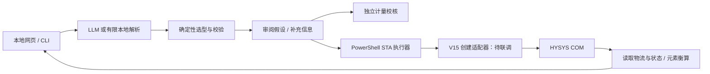

# Reactor Workbench · AI 化工反应器建模工作台

将自然语言需求转换为可检查的建模方案，以确定性规则选型、校验化学计量和单位，区分独立计量校核与 HYSYS 真实求解。

**当前交付为本地开发版，尚未满足考核的完整 HYSYS 闭环。** 用户已选择“先完成本地项目，稍后联调”。已确认远程工作站有 HYSYS V15 图标并可通过 RDP 访问，但未读取该机类型库、未完成反应器创建适配器、未获得 HYSYS 真实结果。不要将本地计量校核或本地功能录像作为 HYSYS 实算证据。

## 立即运行

需要 Node.js 22+（建议使用本次验证版本 24），Windows 自带 PowerShell 5.1 即可执行探测脚本。项目运行时没有 npm 第三方依赖。

```powershell
cd D:\kuyuan
npm start
```

浏览器打开 <http://127.0.0.1:3210>。也可双击 `start.cmd`。

```powershell
npm test
npm run doctor
npm run cli -- plan examples/reforming.txt
npm run cli -- check examples/toluene.txt --accept-assumptions
npm run cli -- check examples/hydrogenation.json
```

`--accept-assumptions` 表示已阅读 `plan` 输出的假设。`plan` 信息不完整时退出码为 2，执行错误为 1。Web 端需勾选相同假设后才能计算。当前电脑未安装 HYSYS，真实计算按钮不可用。

## 自然语言 AI 接入

复制 `.env.example` 为 `.env`，配置 `LLM_BASE_URL`、`LLM_API_KEY` 和 `LLM_MODEL`，重启服务。使用支持 `POST /chat/completions` 和 JSON mode 的 OpenAI 兼容服务。模型名称由账户实际可用型号决定，不写死型号。不支持该接口或 JSON mode 的服务需调整 `src/planner.js`。

密钥只供本机后端请求模型服务，不发送到浏览器，也不进入 Git。未配置密钥和模型时使用**有限本地解析器**，不冒充大模型；只覆盖常见中文必测表达。其他相关反应可直接粘贴 JSON；通用自然语言解析需配置并验证真实模型。目前 LLM 通路经过模拟 HTTP 响应测试，尚无真实账户调用证据。

模型只生成 JSON 建模数据。选型、温压/流量单位、组分名称、元素守恒、缺失参数检查均在确定性代码中执行。模型不能返回代码供执行，也不能生成供展示的模拟结果。补充条件后需重新提交完整需求，旧方案立即失效。

## 必测场景

### 甲烷蒸汽重整

使用 `examples/reforming.txt`。选用 **Equilibrium Reactor**，定义两条独立反应：

```
CH4 + H2O ⇌ CO + 3 H2
CO + H2O ⇌ CO2 + H2
```

进料 520 °C、13.5 bar(a)，出口 710 °C 和 600 °C 分成两个工况。任务允许自定流量，故采用总进料 3700 kmol/h；摩尔比 1:2.7 时为甲烷 1000、水 2700 kmol/h。按 8000 h/a 估算，甲烷约 12.8344 万吨/年，属于说明性处理量假设，不是工厂设计结论。

使用 HYSYS 热化学数据计算平衡常数，不能凭空填 Ka；需检查所选组分的数据可用性、反应相态及平衡基准。等温模型须有能量流，由 HYSYS 计算热负荷。当前不返回平衡产物数值，等待 HYSYS 实算。假设达到化学平衡、不考虑积碳及动力学限制，PR 物性需要在工作站验证适用性。

### 甲苯歧化

选用 **Conversion Reactor**，基于进料甲苯的转化率 50%。2.5 MPa 转换为 25 bar(a)，进料 10000 kg/h、380 °C。原题未给异构体比例，系统会询问，不把总转化率当选择性。`examples/toluene.txt` 为演示明确补充邻:间:对 = 1:1:1；也支持在文本中更改为其他比例。

将三种异构体组成写入**一条等效计量反应**，避免三条各 50% 转化率重复消耗甲苯：

```
2 Toluene → Benzene + (1/3)o-Xylene + (1/3)m-Xylene + (1/3)p-Xylene
```

原题未给出口温度或热负荷，默认并明确声明绝热、零压降，由 HYSYS 求出口温度；独立校核只给总出口组成。等比例下总出口湿基摩尔分数为甲苯 50%、苯 25%、每种二甲苯 8.3333%；剩余甲苯 5000 kg/h。这些是**计量校核值，不是 HYSYS 结果**，也没有假设为热力学平衡异构体分布。

## 通用性与边界

`examples/hydrogenation.json`、`ammonia-equilibrium.json`、`combustion-gibbs.json` 演示额外反应的结构化输入与不同选型。乙烯加氢可执行独立校核，后两者必须等 HYSYS 实算。组分包含自定义英文名时需提供 `formulas` 分子式映射；仍要确认 HYSYS 数据库存在该组分。输入分子式不支持括号、离子、电荷或聚合物。

选择顺序：完整动力学信息 → CSTR/PFR（常规液相/气相）；无动力学且各反应已知转化率 → Conversion；产物分布未知 → Gibbs；明确按已知可逆反应网络求平衡 → Equilibrium。缺少转化率不会自动证明达到平衡。CSTR/PFR 目前只做选型提示并阻止运行，聚合需要专用模型。仅给收率或选择性、缺少足以确定反应程度的数据时也应澄清。

当前物性范围只接受 PR/SRK；电解质、强非理想液相和聚合体系不能作为已支持的工况。计量校核中多条反应的转化率统一基于**原始进料**，不表示串联逐级转化率。并行同基准组分转化率总和不得大于 1，反应物不足时返回错误。

## 架构



`src/hysys.js` 负责互斥、超时、输入快照、日志与独立衡算。`scripts/hysys.ps1` 负责应用/算例生命周期、调用工作站适配器、等待求解、读取汽液出口、保存 `.hsc`。**`scripts/adapters/hysys-v15.ps1` 尚未实现**，缺失时禁止运行；不得填入未经 V15 验证的接口名称伪装完成。详见 [联调说明](docs/HYSYS-INTEGRATION.md)。

每次 HYSYS 执行输出到 `artifacts/<UUID>/`，包含方案、原始结果或失败记录、日志和算例。HYSYS 无法收敛或衡算失败时不降级成假结果。文件不进 Git，以避免提交仿真文件和敏感工艺数据。执行器不关闭已有 HYSYS 算例，不终止 HYSYS 进程。超时终止 PowerShell 子进程，但 HYSYS 自身可能仍在求解，应在 UI 中检查后再运行。

## 验证与交付状态

| 内容 | 当前状态 |
|---|---|
| 自然语言入口、澄清、方案审阅和 JSON 导出 | 已实现，本地解析已验证 |
| 额外反应结构化输入、通用计量核算 | 已实现并验证 |
| LLM 接口 | 已实现，模拟响应验证，真实调用待配置 |
| 单元与 HTTP 集成测试 | `npm test` |
| 浏览器端到端/移动布局 | `scripts/browser-smoke.cjs`，需要 Playwright |
| HYSYS 类型库探测、执行器和结果审计 | 已编写，工作站待执行 |
| HYSYS 反应、反应集、反应器创建适配器 | **待实现与联调** |
| 两个必测场景真实求解及 Live Demo | **待完成** |
| 两页技术报告、脱敏 AI 开发记录 | `output/pdf/`、`docs/` |
| HYSYS 全流程录屏 | **待完成**；本地功能视频不替代它 |
| GitHub 发布 | **待完成**；当前本机 gh 登录凭证无效 |

请阅读 [演示脚本](docs/DEMO.md) 和 [开发记录](docs/DEVELOPMENT.md)。系统只监听 `127.0.0.1`，适用于单机演示。没有实现多用户身份认证，不应直接绑定公网。

## 参考资料

- [AspenTech：Automation and Extensibility](https://esupport.aspentech.com/apex/S_Article?id=000066742)：COM 架构与自动化路径。
- [AspenTech：V15 Unit Operations Guide 入口](https://esupport.aspentech.com/S_Article?id=000103491)：具体 V15 接口与反应配置需结合工作站 Help/类型库核实。
- [OpenAI 官方：Structured model outputs](https://developers.openai.com/api/docs/guides/structured-outputs?api-mode=chat)：JSON mode 只保证 JSON 格式，不保证业务字段满足约束，故后端另做校验。

代码独立编写，没有克隆或复制第三方项目仓库。
